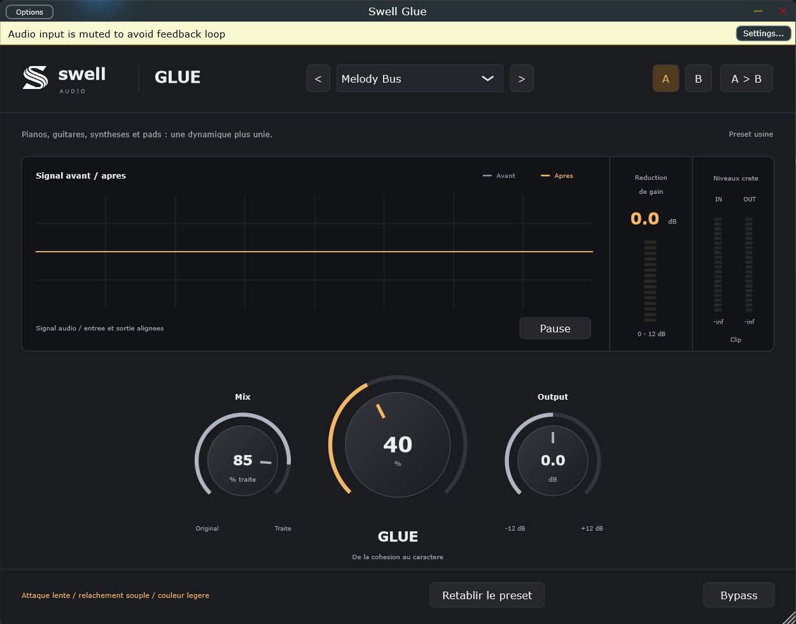

# Swell Glue — 0.1.0

Compression et couleur pour les groupes de drums et d'instruments.
Interface native basée sur la maquette Swell-audio approuvée.

[Télécharger Swell Glue 0.1.0 pour Windows — VST3 et Standalone](https://github.com/sevYOnDaTracks/Swell-Glue/releases/tag/v0.1.0)

## Commandes

- **Glue** dose la compression et une saturation légère. À zéro, le chemin
  original est conservé, avec la latence déclarée au DAW.
- **Mix** mélange le signal original et le signal comprimé, avec compensation
  de latence. À zéro, on conserve le signal original ; Output reste actif.
- **Output** ajuste le gain de -12 à +12 dB. Pas de compensation automatique
  de volume : ajuster Output pour comparer à volume similaire.
- **Bypass** restitue le signal original avec la même latence, sans Output.
- **A / B** compare deux réglages, sauvegardés avec la session. Le bypass est
  commun aux deux. Le bouton de copie duplique le réglage courant dans l'autre case.
- **Pause** fige la courbe uniquement ; les niveaux et le traitement restent actifs.
- Double-clic sur Glue / Mix / Output : 0 % / 100 % / 0 dB.

## Six presets

| Preset | Intention |
| --- | --- |
| Gentle Glue | Cohésion légère, transitoires préservées |
| Drum Bus | Compression des drums avec attaque préservée |
| Parallel Punch | Compression marquée, mélangée au signal original |
| Warm Bus | Couleur plus présente et relâchement doux |
| Pump | Attaque courte pour un pompage plus audible |
| Melody Bus | Attaque lente, relâchement souple, couleur légère |

Le menu charge le style et ses valeurs Glue/Mix/Output. Dans le DAW, le paramètre
automatisable **Style** change uniquement le caractère interne ; les trois autres
paramètres restent indépendants pour ne pas écraser leur automation.

## Affichage et audio

Les courbes représentent les enveloppes min/max des vrais signaux d'entrée et
de sortie, alignés en latence. En stéréo, elles englobent les deux canaux.
Les niveaux indiquent les crêtes échantillonnées, pas les true peaks.
La réduction de gain correspond au compresseur avant le mélange Mix.
Le témoin Clip reste visible brièvement après un dépassement de 0 dBFS.

Le moteur lie la détection en stéréo, utilise une transition douce de compression,
un filtre de détection à 70 Hz et un suréchantillonnage FIR 4x pour la saturation.
Les transitions des paramètres sont lissées. Aucun limiteur n'est ajouté en sortie.
Cette première version doit encore être évaluée à l'écoute sur différents bus réels.

## Windows

Copier le dossier complet `Swell Glue.vst3` dans
`C:\Program Files\Common Files\VST3`, puis relancer le scan des plugins.
Le Standalone `Swell Glue.exe` traite une entrée audio ; il ne contient pas de lecteur
de samples. Choisir l'interface audio dans Options. Son entrée est coupée par défaut
pour éviter le larsen. Le VST3 utilise le signal fourni par le DAW.

## Compilation

Windows : Visual Studio 2022 C++, CMake et Git ; lancer `build.ps1`.
Mac : Xcode, CMake et Git ; lancer `sh build-mac.sh`.
Sorties : `build/SwellGlue_artefacts/Release/`.
Formats : Windows VST3 et Standalone ; Mac VST3, AU et Standalone universels
Intel/Apple Silicon. La configuration Mac ne remplace pas une compilation et
une validation sur Mac. VST2 n'est pas configuré ; les binaires ne sont pas signés.

Les tests vérifient les six presets, le moteur audio, les états A/B, la restauration
de session, la latence, Mix à zéro, le gain Output, les deux bypass, les tailles
variables de blocs, les vrais niveaux et l'alimentation de l'affichage.

JUCE 8.0.6 est téléchargé par CMake. JUCE est sous AGPLv3 ou licence commerciale :
choisir une licence adaptée avant distribution.
